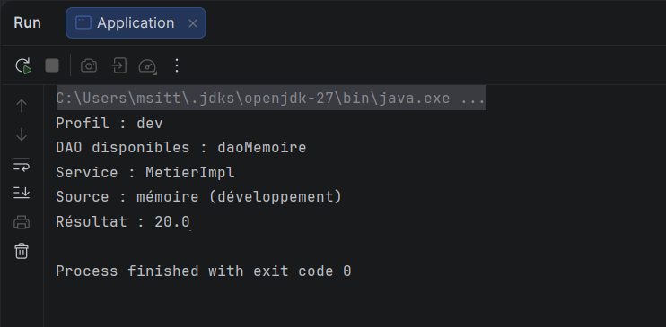

# TP : Inversion de contrôle et injection de dépendances avec Spring

## Objectif

L'objectif de ce laboratoire est de créer une application Java avec Spring, mettant en œuvre l'inversion de contrôle (IoC) et l'injection de dépendances (DI) via des annotations. Nous allons développer une interface DAO, une interface métier et confier à Spring la création et l'assemblage de leurs implémentations.

Le projet contient la solution complète, trois scénarios exécutables et des tests d'intégration du conteneur. Il utilise Spring Framework directement et Maven pour la compilation et les dépendances.

## Prérequis

- JDK 17 ou supérieur ; JDK 17 recommandé pour reproduire la configuration de compilation.
- Maven 3.6.3 ou supérieur, ou le Maven intégré à IntelliJ IDEA.
- Un accès à Internet pour le premier téléchargement des dépendances.
- Connaissances des interfaces, des classes, des constructeurs et des packages Java.

Les versions sont fixées dans `pom.xml` : Spring Framework 7.0.9 et JUnit Jupiter 5.12.2. La cible de compilation est Java 17.

## Démarrage dans IntelliJ IDEA

1. Ouvrir le dossier contenant ce `README.md` et `pom.xml` avec **File > Open**.
2. Charger le projet comme projet Maven et attendre la résolution des dépendances. Si nécessaire, utiliser **Reload All Maven Projects** dans la fenêtre Maven.
3. Choisir un JDK 17 ou supérieur dans **File > Project Structure > Project SDK**. Vérifier également le JDK du lanceur Maven dans les paramètres Maven de l'IDE.
4. Ouvrir `src/main/java/tp/presentation/Application.java` et exécuter sa méthode `main`.
5. Sans argument, le scénario `dev` est utilisé. Dans la configuration d'exécution de cette classe, saisir `prod` ou `qualifier` dans **Program arguments**, puis relancer.

Les valeurs `dev`, `prod` et `qualifier` sont des profils Spring. Ce projet ne définit pas de profils Maven : ne pas utiliser `mvn -Pprod` pour les sélectionner.

## Démarrage dans un terminal

Ouvrir le terminal à la racine du projet, là où se trouve `pom.xml`.

```sh
mvn clean test
mvn compile exec:java
mvn compile exec:java "-Dexec.args=prod"
mvn compile exec:java "-Dexec.args=qualifier"
```

Les guillemets autour de `-Dexec.args=...` conviennent notamment à PowerShell. Si `mvn` n'est pas reconnu, utiliser le Maven intégré à IntelliJ ou installer Maven et l'ajouter au `PATH`.

On peut également activer le profil avec la propriété Spring standard :

```sh
mvn compile exec:java "-Dspring.profiles.active=prod"
```

La variable d'environnement `SPRING_PROFILES_ACTIVE` est une autre possibilité. Un argument de programme explicite prend la priorité dans cette application. En l'absence de profil actif, elle configure `dev` comme profil par défaut. Pour ce TP, un seul profil parmi les trois est accepté à la fois.

## Résultats attendus

### Scénario 1 : profil `dev`

```text
Profil : dev
DAO disponibles : daoMemoire
Service : MetierImpl
Source : mémoire (développement)
Résultat : 20.0
```

Le DAO en mémoire retourne `10`. Le service multiplie cette valeur par `2`.
**Capture de l'exécution dans IntelliJ IDEA — profil `dev` :**



La capture confirme le résultat `20.0` et la fin du programme avec le code de sortie `0`.

### Scénario 2 : profil `prod`

```text
Profil : prod
DAO disponibles : daoApi
Service : MetierImpl
Source : API distante simulée
Résultat : 50.0
```

Le service métier est identique. Spring lui fournit une autre implémentation DAO, qui retourne `25`. L'API est simulée : aucun appel HTTP ni accès à une base de données n'est effectué.

### Scénario 3 : profil pédagogique `qualifier`

```text
Profil : qualifier
DAO disponibles : daoApi, daoMemoire
Service : MetierQualifie
Source : API distante simulée
Résultat : 50.0
```

Les deux DAO sont présents dans le contexte. Le service `MetierQualifie` demande explicitement celui nommé `daoApi` avec `@Qualifier`. Le profil `qualifier` sert à isoler cette démonstration ; ce nom n'a aucun comportement spécial dans Spring.

Des lignes de journalisation Maven ou Spring peuvent également apparaître autour de ces sorties.

## Architecture du projet

```text
tp-spring-ioc/
├── pom.xml
├── README.md
├── VALIDATION.md
└── src/
    ├── main/java/tp/
    │   ├── config/AppConfig.java
    │   ├── dao/IDao.java
    │   ├── dao/DaoMemoire.java
    │   ├── dao/DaoApi.java
    │   ├── metier/IMetier.java
    │   ├── metier/MetierImpl.java
    │   ├── metier/MetierQualifie.java
    │   └── presentation/Application.java
    └── test/java/tp/SpringInjectionTest.java
```

Le déroulement du démarrage est : sélection du profil → scan des composants → création des beans → injection du DAO → récupération du service → calcul.

## Étape 1 : Créer le projet Maven

Étudier `pom.xml`. Les coordonnées du projet sont `fr.tp:tp-spring-ioc:1.0.0`.

La dépendance `spring-context` apporte le conteneur d'application et les annotations utilisées dans ce TP. Maven résout également ses dépendances transitives. JUnit est déclaré avec la portée `test` et sert à vérifier les configurations.

Les plugins configurent la compilation Java 17, l'exécution des tests et le lancement de `tp.presentation.Application` avec `exec:java`.

## Étape 2 : Définir le contrat DAO

Ouvrir `IDao.java` :

```java
public interface IDao {
    double getData();
}
```

L'interface décrit l'opération attendue sans imposer de source de données. `DaoMemoire` et `DaoApi` respectent le même contrat, mais fournissent des valeurs différentes.

## Étape 3 : Déclarer les DAO comme beans

La première implémentation porte les annotations suivantes :

```java
@Repository("daoMemoire")
@Profile({"dev", "qualifier"})
public class DaoMemoire implements IDao { /* voir le fichier source */ }
```

La seconde utilise :

```java
@Repository("daoApi")
@Profile({"prod", "qualifier"})
public class DaoApi implements IDao { /* voir le fichier source */ }
```

`@Repository` identifie ici les composants d'accès aux données et leur attribue un nom de bean. Plusieurs valeurs dans `@Profile` signifient que l'une d'elles suffit pour rendre le composant admissible.

| Profil | DAO enregistrés | Service enregistré |
| --- | --- | --- |
| `dev` | `daoMemoire` | `MetierImpl` |
| `prod` | `daoApi` | `MetierImpl` |
| `qualifier` | `daoMemoire`, `daoApi` | `MetierQualifie` |

## Étape 4 : Définir le métier et injecter sa dépendance

`IMetier` déclare `double calcul()`. Sa première implémentation dépend de `IDao` :

```java
@Service
@Profile({"dev", "prod"})
public class MetierImpl implements IMetier {
    private final IDao dao;

    @Autowired
    public MetierImpl(IDao dao) {
        this.dao = dao;
    }

    @Override
    public double calcul() {
        return dao.getData() * 2;
    }
}
```

Spring fournit le DAO au constructeur. La dépendance est obligatoire et le champ peut rester `final`. La classe ne contient aucun `new DaoMemoire()` ni `new DaoApi()`.

`@Autowired` est affiché explicitement pour l'apprentissage. Avec un seul constructeur, Spring peut déjà l'utiliser sans cette annotation. Voir la [documentation officielle sur l'injection](https://docs.spring.io/spring-framework/reference/core/beans/annotation-config/autowired.html).

**IoC :** la responsabilité de créer et d'assembler ces composants est confiée au conteneur. **DI :** le conteneur fournit concrètement la dépendance DAO au service. Le programme principal crée le contexte, puis lui demande le service déjà assemblé.

## Étape 5 : Scanner les composants

Étudier `AppConfig.java` :

```java
@Configuration
@ComponentScan(basePackages = "tp")
public class AppConfig {
}
```

Cette classe définit la configuration Java. Le scan parcourt le package `tp` et ses sous-packages pour trouver les composants annotés, en tenant compte des profils.

## Étape 6 : Démarrer le conteneur

Ouvrir `Application.java`. Les instructions essentielles sont :

```java
contexte.getEnvironment().setDefaultProfiles("dev");
// Si un argument est fourni, définir le profil actif avant refresh().
contexte.register(AppConfig.class);
contexte.refresh();
IMetier metier = contexte.getBean(IMetier.class);
```

Le profil est choisi avant `refresh()`, qui initialise le contexte et les beans. Changer la valeur après le démarrage ne remplace pas automatiquement les objets existants. Le `try-with-resources` ferme le contexte à la fin.

La classe principale affiche aussi les noms des beans DAO pour rendre observable l'effet du profil.

## Étape 7 : Sélectionner une implémentation avec `@Qualifier`

Ouvrir `MetierQualifie.java`. Son constructeur est :

```java
@Autowired
public MetierQualifie(@Qualifier("daoApi") IDao dao) {
    this.dao = dao;
}
```

Dans le scénario `qualifier`, deux beans satisfont le type `IDao`. L'annotation réduit les candidats à celui désigné par `daoApi` dans ce projet. Elle ne crée pas un bean absent et n'active aucun profil. Voir la [documentation officielle sur les qualificateurs](https://docs.spring.io/spring-framework/reference/core/beans/annotation-config/autowired-qualifiers.html).

Exercice : remplacer temporairement `"daoApi"` par `"daoMemoire"`, puis recompiler et relancer le profil `qualifier`. Le résultat devient `20.0`. Restaurer ensuite le code d'origine pour que les tests fournis restent valides.

## Étape 8 : Comprendre les profils

Exécuter successivement les scénarios `dev` et `prod`. `MetierImpl` reste inchangé ; seule la sélection des beans DAO varie. Les annotations `@Profile` contrôlent leur enregistrement selon l'environnement actif. Voir la [documentation officielle sur les profils](https://docs.spring.io/spring-framework/reference/core/beans/environment.html).

Le profil par défaut `dev` est défini explicitement par ce programme. Spring ne choisit pas spontanément ce nom. La validation d'un seul profil est également une règle de ce TP : Spring permet en général plusieurs profils actifs.

## Étape 9 : Vérifier le fonctionnement

Lancer `mvn test` ou exécuter `SpringInjectionTest` dans IntelliJ. Les cinq tests vérifient :

1. Le profil `dev` ne crée que le DAO mémoire et produit `20.0`.
2. Le profil `prod` ne crée que le DAO API et produit `50.0`.
3. Le profil `qualifier` crée les deux DAO, sélectionne le service qualifié et produit `50.0`.
4. Le profil par défaut utilise le DAO mémoire.
5. Le programme rejette un nom de profil inconnu.

Ces tests ouvrent de vrais contextes Spring : ils vérifient l'assemblage effectif des beans.

## Expériences et erreurs à observer

Effectuer chaque modification séparément, puis la restaurer.

| Manipulation | Observation attendue |
| --- | --- |
| Retirer `@Qualifier` de `MetierQualifie` et lancer `qualifier` | Démarrage impossible : deux DAO sont candidats ; rechercher `NoUniqueBeanDefinitionException` dans les causes |
| Utiliser `@Qualifier("daoInexistant")` | Aucun bean ne satisfait le qualificateur |
| Retirer `@Repository` de `DaoMemoire` et lancer `dev` | Dépendance DAO introuvable |
| Retirer `@Autowired` du constructeur unique | L'injection continue de fonctionner |
| Passer l'argument `inconnu` | Message demandant `dev`, `prod` ou `qualifier` |

## Questions de compréhension et correction

1. **Qu'est-ce qu'un bean ?** Un objet géré par le conteneur Spring.
2. **Pourquoi utiliser `IDao` ?** Pour découpler le calcul de l'implémentation qui fournit les données.
3. **Qui instancie les DAO et les services ?** Le conteneur Spring lors de l'initialisation du contexte.
4. **Quel est le rôle de `@ComponentScan` ?** Rechercher les composants dans les packages configurés.
5. **Quelle différence entre profil et qualificateur ?** Le profil conditionne l'enregistrement des beans ; le qualificateur sélectionne parmi les candidats à une injection.
6. **Pourquoi privilégier le constructeur ici ?** Il exprime la dépendance obligatoire et permet un champ immuable.
7. **En quoi ce TP prolonge-t-il celui sur la réflexion ?** L'assemblage est désormais assuré par Spring à partir des annotations et de la configuration.

## Travail à remettre

- Le projet Maven et ses sources.
- Les captures des exécutions `dev`, `prod` et `qualifier`.
- Le résultat des tests.
- Une explication de la différence entre IoC, DI, `@Qualifier` et `@Profile`.
- Les observations d'au moins deux expériences sur les erreurs.

## Conclusion

Dans ce TP, vous avez appris à créer un projet Spring avec Maven, définir des interfaces et leurs implémentations, injecter les dépendances par annotations, configurer le scan des composants, exécuter un contexte Spring, sélectionner une implémentation avec `@Qualifier` et activer des implémentations selon des profils.

Le résultat illustre les principes d'inversion de contrôle et d'injection de dépendances dans une application console simple. Il fournit une base pour étudier ensuite Spring Boot, les tests avec des doubles et les configurations de services plus élaborées.

